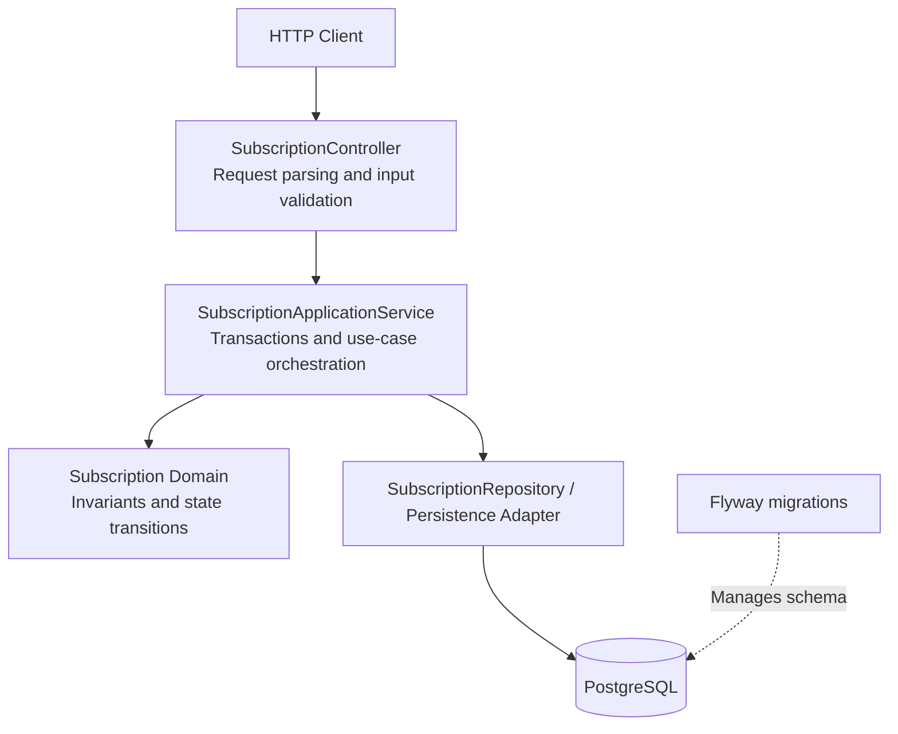
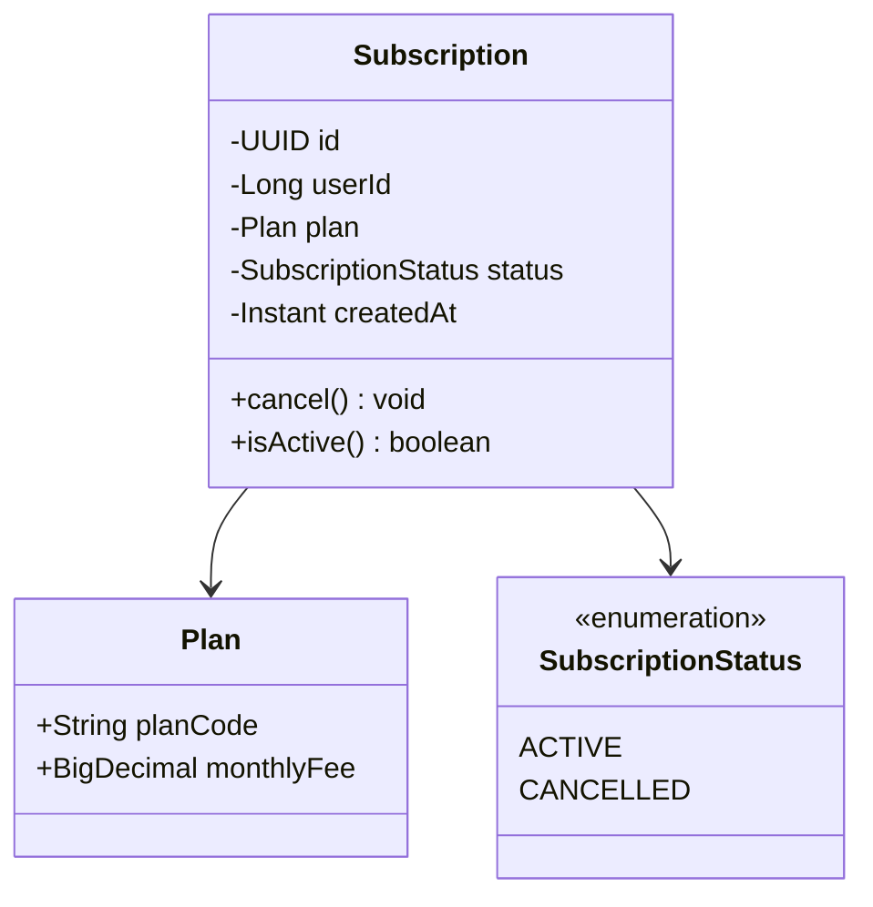
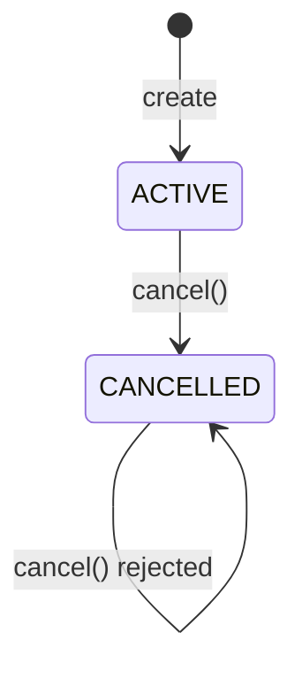
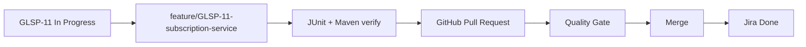

# GLSP-11 — Subscription Service Design Document (English)

> **中文文档：** [GLSP-11 订阅服务设计文档（简体中文）](GLSP-11-subscription-service-design.zh-CN.md)

> **Project:** Game Leaderboard & Subscription Platform (GLSP)  
> **Jira:** [GLSP-11 — Create Subscription Service and subscription lifecycle API](https://wujinxin5257.atlassian.net/browse/GLSP-11)  
> **Status:** In Progress (as of 2026-11-23)  
> **Technology stack:** Java 21, Spring Boot, JUnit 5; Spring Data JPA, PostgreSQL, Flyway, and REST API are planned  
> **Purpose:** Domain modeling, system design, implementation guidance, testing, and maintenance

## 1. Background and Objectives

Extend the completed **GLSP-10 BillingCalculator** exercise with a Subscription Service that can create, retrieve, and cancel subscriptions.

This phase focuses on applying three principles:

1. **Encapsulation:** Prevent outside code from arbitrarily modifying subscription state; expose meaningful domain operations instead.
2. **Finite State Machine (FSM):** Explicitly define valid states and allowed state transitions.
3. **Domain Invariants:** Maintain business constraints when a subscription is created and after each valid domain operation.

### 1.1 Jira Acceptance Criteria

- [ ] Implement REST APIs to create, retrieve, and cancel subscriptions.
- [ ] Define domain models including `Plan` and `SubscriptionStatus`.
- [ ] Persist subscriptions in PostgreSQL and manage schema versions with Flyway.
- [ ] Test valid behavior and invalid state transitions using JUnit and API tests.

> **Scope note:** The REST, JPA, and database designs below are planned implementations. They are not evidence that those features have already been built.

## 2. Confirmed Progress and Outstanding Work

| Component | Status | Evidence or notes |
|---|---|---|
| GitHub feature branch | To verify | Intended branch: `feature/GLSP-11-subscription-service`; verify the actual local branch |
| Java domain package | Created | `com.example.subscription.domain`; main source compilation succeeded |
| Basic subscription state model | Implemented and tested | `ACTIVE` and `CANCELLED` |
| `cancel()` state transition | Implemented and tested | Both successful cancellation and repeated-cancellation behavior passed |
| JUnit 5 domain tests | Verified | `SubscriptionTest`: 3 tests, 0 failures, 0 errors, 0 skipped |
| Full `Subscription` invariants | Pending / requires retesting | Need to verify `id`, `userId`, `plan`, and `createdAt` validation |
| REST Controller / Application Service | Not yet confirmed complete | No verified HTTP test result |
| JPA and Flyway | Not yet confirmed complete | No verified schema or persistence test result |
| GitHub PR / CI/CD | Not completed for this story | No evidence of a merged GLSP-11 PR |

Verified commands: `./mvnw -DskipTests compile` returned **BUILD SUCCESS**; `./mvnw -Dtest=SubscriptionTest test` returned **3 tests passed**. Maven also reported HTTP 401 metadata warnings from Flyway/Redgate repositories, but they did not block either run. Investigate if dependency resolution fails later.

## 3. Target System Architecture



### Layer Responsibilities

| Layer | Responsible for | Not responsible for |
|---|---|---|
| Controller | Request DTO validation, HTTP status codes, calling application services | Complex domain state transitions |
| Application Service | Orchestrating use cases, loading/saving aggregates, transaction boundaries | Bypassing the domain model to alter business state |
| Domain | Invariants, state transitions, subscription behaviors | Depending on HTTP frameworks or database connections |
| Repository / Persistence Adapter | Persistence and reconstruction of domain objects | Deciding whether cancellation is allowed |
| Flyway | Database schema migrations | Executing runtime business logic |

**Initial architecture decision:** Implement a pure Java domain model in the existing Maven project first. A separate `subscription-service` Maven module can be introduced later. If domain models and JPA entities are separate, use a dedicated mapper and ensure reconstruction does not bypass invariants.

## 4. Domain Model Design

### 4.1 Model Relationships



### 4.2 Domain Objects

- **Subscription:** Aggregate root that owns subscription state and protects its business invariants.
- **Plan:** Value object containing `planCode` and `monthlyFee`; initially modeled as an immutable Java `record`.
- **SubscriptionStatus:** Enum currently limited to `ACTIVE` and `CANCELLED`.

**Suggested implementation:**

```java
package com.example.subscription.domain;

public enum SubscriptionStatus {
    ACTIVE,
    CANCELLED
}
```

```java
package com.example.subscription.domain;

import java.math.BigDecimal;

public record Plan(String planCode, BigDecimal monthlyFee) {
    public Plan {
        if (planCode == null || planCode.isBlank()) {
            throw new IllegalArgumentException("Invalid plan code");
        }
        if (monthlyFee == null || monthlyFee.signum() < 0) {
            throw new IllegalArgumentException("Invalid monthly fee");
        }
    }
}
```

### 4.3 Domain Invariants

| Invariant | Validation location | Behavior on invalid input |
|---|---|---|
| `id` must be non-null and identify a subscription | Factory / reconstruction logic | Reject creation or reconstruction |
| `userId` must be non-null and greater than zero | Constructor | `IllegalArgumentException` |
| `plan` must be non-null | Constructor | `IllegalArgumentException` or a documented validation exception |
| `plan.planCode` must not be blank | `Plan` constructor | `IllegalArgumentException` |
| `plan.monthlyFee >= 0` | `Plan` constructor | `IllegalArgumentException` |
| `status` must not be null | Creation and persistence reconstruction | Reject invalid state |
| `createdAt` must not be null | Creation and persistence reconstruction | Reject invalid state |

> The earlier basic exercise also used `Objects.requireNonNull()`, which throws `NullPointerException` by default. If the HTTP layer should consistently return 400 for invalid business inputs, decide on and document a consistent validation exception strategy before implementation.

## 5. Finite State Machine (FSM)

For this exercise: **New subscriptions start as ACTIVE; ACTIVE subscriptions can be cancelled; attempting to cancel an already CANCELLED subscription throws an exception.** Additional statuses such as PENDING, SUSPENDED, and EXPIRED are out of scope.



| Current state | Operation | Expected behavior |
|---|---|---|
| None | `create` | Create an `ACTIVE` subscription |
| `ACTIVE` | `cancel()` | Transition to `CANCELLED` |
| `CANCELLED` | `cancel()` | Throw `IllegalStateException` and leave state unchanged |

This exercise treats repeated cancellation as an error. A real SaaS API may choose idempotent cancellation instead; changing the rule requires updating the acceptance criteria and tests.

### 5.1 Domain Method Example

```java
public void cancel() {
    if (status != SubscriptionStatus.ACTIVE) {
        throw new IllegalStateException(
            "Only active subscriptions can be cancelled"
        );
    }
    status = SubscriptionStatus.CANCELLED;
}
```

**Rationale:** Keep the state field `private`; clients call `cancel()` rather than `setStatus(CANCELLED)`. Business constraints belong in the domain object instead of being duplicated across HTTP controllers, consumers, and other entry points.

## 6. REST API Design (Planned)

| Method | Endpoint | Purpose | Expected response |
|---|---|---|---|
| POST | `/api/subscriptions` | Create a subscription | `201 Created` |
| GET | `/api/subscriptions/{id}` | Retrieve a subscription | `200 OK`, or `404` if missing |
| POST | `/api/subscriptions/{id}/cancel` | Cancel a subscription | `200 OK` or `204 No Content` (select one consistently) |

### 6.1 Create Subscription

```http
POST /api/subscriptions
Content-Type: application/json

{"userId":100,"planCode":"PREMIUM"}
```

Illustrative planned response:

```json
{
  "id": "4efb265b-d3ac-4c80-95c9-5f8db24f4cca",
  "userId": 100,
  "planCode": "PREMIUM",
  "monthlyFee": 980,
  "status": "ACTIVE",
  "createdAt": "2026-11-23T09:00:00Z"
}
```

The server should obtain the trusted plan price from the `planCode` (configuration or database), **not accept a freely supplied price from the client**. `PREMIUM = JPY 980` is an exercise assumption, not real commercial pricing.

### 6.2 Cancel Subscription

```http
POST /api/subscriptions/{id}/cancel
```

Proposed HTTP error mapping (to finalize during implementation):

| Scenario | HTTP status |
|---|---|
| Invalid request data | `400 Bad Request` |
| Subscription not found | `404 Not Found` |
| Already cancelled subscription | `409 Conflict` |
| Unexpected server/database error | `500 Internal Server Error`, without leaking internal implementation details |

Use `@RestControllerAdvice` to map domain exceptions to consistent HTTP responses. Do not expose internal stack traces to API clients.

## 7. PostgreSQL / Flyway Persistence Design (Planned)

Two initial tables are proposed. Add them using the next available Flyway migration version:

```sql
-- Example only: choose a Flyway version not already present in this repository.
CREATE TABLE subscription_plans (
    plan_code VARCHAR(40) PRIMARY KEY,
    monthly_fee NUMERIC(19, 2) NOT NULL CHECK (monthly_fee >= 0)
);

CREATE TABLE subscriptions (
    id UUID PRIMARY KEY,
    user_id BIGINT NOT NULL CHECK (user_id > 0),
    plan_code VARCHAR(40) NOT NULL REFERENCES subscription_plans(plan_code),
    status VARCHAR(20) NOT NULL CHECK (status IN ('ACTIVE', 'CANCELLED')),
    created_at TIMESTAMPTZ NOT NULL,
    version BIGINT NOT NULL DEFAULT 0
);

CREATE INDEX idx_subscriptions_user_id ON subscriptions(user_id);
```

**Before implementing:** Inspect existing migrations under `src/main/resources/db/migration/` and the actual PostgreSQL configuration. Do not overwrite an existing V1 migration or reuse a version number.

Implementation considerations:

- Validate business rules within the domain; use database `NOT NULL`, `CHECK`, primary keys, and foreign keys as additional integrity safeguards.
- Reserve `version` for optimistic concurrency control; verify behavior with JPA `@Version` and integration tests.
- Make loading the active subscription, performing `cancel()`, and saving the new state a consistent transaction.
- Decide whether price changes affect existing subscriptions or whether their prices are locked. Price versioning is not included in this phase.

## 8. Testing Strategy

### 8.1 Completed Domain Unit Tests

Command:

```bash
./mvnw -Dtest=SubscriptionTest test
```

Verified Maven result:

```text
Tests run: 3, Failures: 0, Errors: 0, Skipped: 0
BUILD SUCCESS
```

Covered: new subscription starts ACTIVE; active subscription can be cancelled; repeated cancellation throws an exception.

### 8.2 Additional Unit Tests to Implement

| Test case | Input | Expected outcome |
|---|---|---|
| Null user ID | `null` | Reject creation |
| Invalid user ID | `0`, `-1` | Reject creation |
| Null plan | `null` | Reject creation |
| Blank plan code | `" "` | Reject creation |
| Negative monthly fee | `-980` | Reject creation |
| Valid creation | `userId=100`, PREMIUM | Non-null ID/time and ACTIVE |
| Repeated cancellation | Two `cancel()` calls | Second call throws; state remains CANCELLED |

### 8.3 Planned API and Persistence Integration Tests

- POST creation, followed by GET with the returned ID.
- POST cancellation, followed by GET returning `CANCELLED`.
- Invalid JSON and parameters return 400.
- Unknown subscription ID returns 404.
- Repeated cancellation returns the agreed 409 response.
- PostgreSQL reads and writes are consistent; Flyway migrations succeed against an empty database.
- Concurrent cancellations do not create invalid state or lost updates.

## 9. CI/CD and Jira Development Workflow



Suggested steps (**check for important uncommitted changes first**):

```bash
cd ~/Downloads/game-leaderboard-api
git status
git switch main
git pull --ff-only origin main
git switch -c feature/GLSP-11-subscription-service
```

If the feature branch already exists, use `git switch feature/GLSP-11-subscription-service` rather than creating it again.

Validation commands:

```bash
./mvnw -Dtest=SubscriptionTest test
./mvnw clean verify
git status --short
git diff --check
```

Suggested PR title: `GLSP-11 feat: implement subscription lifecycle API`. Include the Jira issue key in branch names, commits, and PRs to support development traceability. Transition `GLSP-11` to Done only after implementation, CI quality gates, and PR merge are verified.

## 10. Planned Implementation Sequence

1. **Domain Model:** Complete `Subscription`, `Plan`, `SubscriptionStatus`, and domain unit tests.
2. **Persistence:** Inspect existing Flyway versions; add schema, JPA entity, mapper, and repository.
3. **Application Service:** Implement create, retrieve, cancel, and transaction handling.
4. **REST API:** Introduce controllers, DTOs, and exception mapping.
5. **Integration Tests:** Verify PostgreSQL, Flyway, HTTP behavior, and invalid transitions.
6. **DevOps:** Run Maven Verify and PR quality gates, merge, and update Jira.

## 11. Design Decisions and Open Questions

| Topic | Current approach | Status |
|---|---|---|
| Initial subscription status | `ACTIVE` | Defined for this exercise |
| Repeated cancellation | Throw `IllegalStateException` | Defined for this exercise |
| API error mapping | Repeated cancellation → 409 | Proposed, not yet implemented |
| Subscription ID | UUID | Design proposal |
| Domain model vs. JPA entity | Separate with mapper | Design proposal |
| Timestamp type | `Instant` / PostgreSQL `TIMESTAMPTZ` | Design proposal |
| Plan price source | Trusted server-side configuration / database | To implement |
| Concurrency control | Optimistic locking | To verify |
| Effective cancellation timing | Immediate cancellation | Simplification; reassess for real billing products |
| Multiple active subscriptions per user | Not yet specified | Business decision required |

---

> **Document integrity:** This is a design and implementation guide for GLSP-11. Planned REST/JPA/Flyway work must not be presented as completed. The only verified execution at this point is the domain compilation and the three passing `SubscriptionTest` cases.
