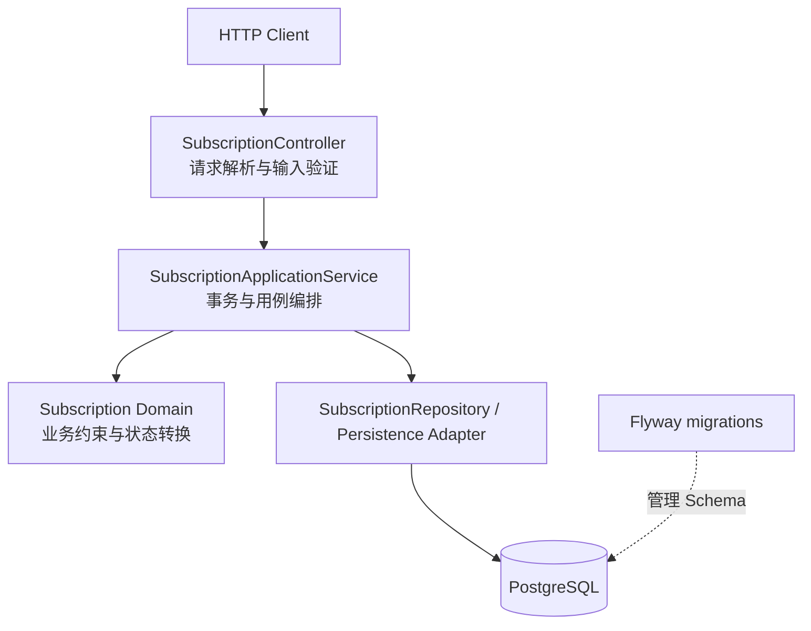
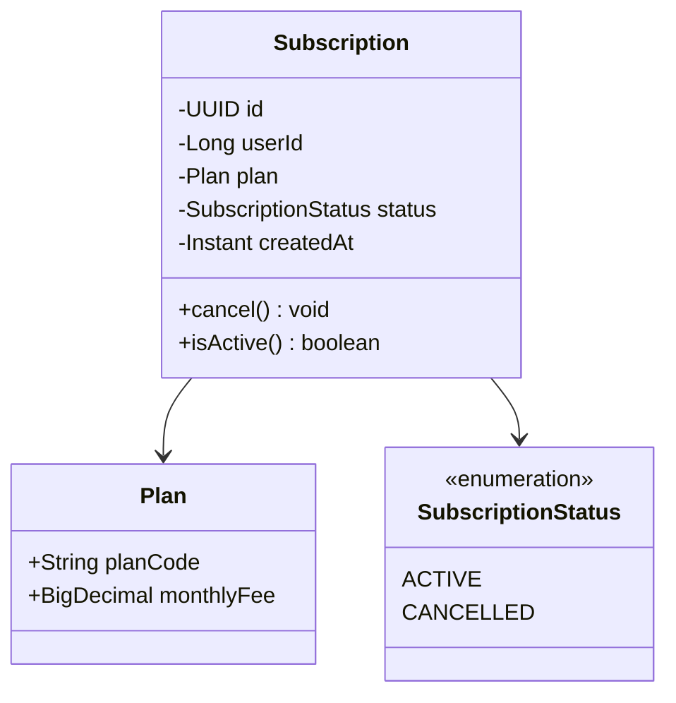
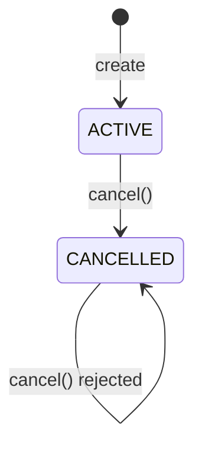
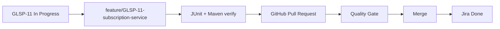

# GLSP-11 — Subscription Service 设计文档（简体中文）

> **Language:** [English](GLSP-11-subscription-service-design.en.md) | 简体中文

> **项目**：Game Leaderboard & Subscription Platform（GLSP）  
> **Jira**：[GLSP-11 — Create Subscription Service and subscription lifecycle API](https://wujinxin5257.atlassian.net/browse/GLSP-11)  
> **状态**：In Progress（截至 2026-11-23）  
> **技术栈**：Java 21、Spring Boot、JUnit 5；计划引入 Spring Data JPA、PostgreSQL、Flyway、REST API  
> **文档用途**：领域建模、系统设计、实现指导、测试计划和开发维护

## 1. 背景与目标

从已完成的 **GLSP-10 BillingCalculator** 练习继续扩展订阅业务，实现可创建、查询、取消订阅的 Subscription Service。

本阶段重点学习并实践三个原则：

1. **Encapsulation（封装）**：订阅内部状态不可被外部代码任意更改；通过领域行为完成修改。
2. **Finite State Machine（有限状态机，FSM）**：显式规定允许的状态及其转换规则。
3. **Domain Invariant（领域不变量）**：在订阅对象创建及每次有效业务操作结束后，都必须维护业务约束。

### 1.1 Jira 验收标准

- [ ] 实现 Subscription 创建、查询和取消的 REST API。
- [ ] 定义 `Plan`、`SubscriptionStatus` 等领域模型。
- [ ] 使用 PostgreSQL 保存订阅数据，并通过 Flyway 管理 Schema。
- [ ] 通过 JUnit 与 API 测试验证正常路径和非法状态转换。

> **注意**：下述 REST/JPA/数据库设计是待实施的方案，不代表相关功能已经存在。

## 2. 已确认进度与待实现范围

| 模块 | 当前状态 | 依据或说明 |
|---|---|---|
| GitHub 功能开发分支 | 待核实 | 计划使用 `feature/GLSP-11-subscription-service`，以本地实际分支为准 |
| Java Domain Package | 已建立 | `com.example.subscription.domain`，已有主代码编译成功记录 |
| 基础订阅状态模型 | 已实现并测试 | `ACTIVE`、`CANCELLED` |
| `cancel()` 状态转换 | 已实现并测试 | 合法取消和重复取消场景均通过 |
| JUnit 5 领域测试 | 已验证通过 | `SubscriptionTest`：3 tests / 0 failures / 0 errors / 0 skipped |
| 完整 `Subscription` 不变量 | 待实现/待复验 | 需确认 `id`、`userId`、`plan`、`createdAt` 等校验 |
| REST Controller / Application Service | 未完成 | 尚无已确认的 HTTP 测试结果 |
| JPA 与 Flyway | 未完成 | 尚无已确认的 Schema 和持久化测试结果 |
| GitHub PR / CI/CD | 未完成 | 本 Story 尚未提供合并证据 |

编译记录：`./mvnw -DskipTests compile` → **BUILD SUCCESS**；运行测试：`./mvnw -Dtest=SubscriptionTest test` → **3 tests passed**。曾出现 Flyway/Redgate Maven Repository 元数据 HTTP 401 警告，但没有阻止这两次构建；若将来依赖解析失败再调查。

## 3. 目标系统架构



### 各层职责

| 层次 | 应负责 | 不应负责 |
|---|---|---|
| Controller | 请求 DTO 验证、HTTP 状态码、调用应用服务 | 直接执行复杂业务状态转换 |
| Application Service | 处理用例、加载与保存聚合、事务边界 | 绕开领域对象直接修改状态 |
| Domain | 不变量、状态转换、订阅行为 | 依赖 Web 框架或数据库连接 |
| Repository / Persistence Adapter | 持久化和领域对象重建 | 决定“是否允许取消”的业务规则 |
| Flyway | 数据库版本迁移 | 执行运行时业务逻辑 |

**初始架构选择**：暂时在现有 Maven 项目中实现纯 Java Domain Model；后续可以拆分为独立 `subscription-service` Maven 模块。若采用领域模型和 JPA Entity 分离的方式，需要提供转换器/映射器，避免在重建对象时绕过不变量。

## 4. 领域模型设计

### 4.1 模型关系



### 4.2 领域对象

- **Subscription**：订阅聚合根，负责维护订阅状态及相关不变量。
- **Plan**：套餐值对象，包含 `planCode`、`monthlyFee`，先用不可变 Java `record` 表示。
- **SubscriptionStatus**：枚举，当前只定义 `ACTIVE` 与 `CANCELLED`。

**实现建议**：

```java
package com.example.subscription.domain;

public enum SubscriptionStatus {
    ACTIVE,
    CANCELLED
}
```

```java
package com.example.subscription.domain;

import java.math.BigDecimal;

public record Plan(String planCode, BigDecimal monthlyFee) {
    public Plan {
        if (planCode == null || planCode.isBlank()) {
            throw new IllegalArgumentException("Invalid plan code");
        }
        if (monthlyFee == null || monthlyFee.signum() < 0) {
            throw new IllegalArgumentException("Invalid monthly fee");
        }
    }
}
```

### 4.3 领域不变量

| 规则 | 校验位置 | 非法输入处理 |
|---|---|---|
| `id` 非空且能够标识订阅 | 工厂/重建逻辑 | 拒绝创建/重建 |
| `userId` 非空且 > 0 | 构造函数 | `IllegalArgumentException` |
| `plan` 非空 | 构造函数 | `IllegalArgumentException` 或明确约定的校验异常 |
| `plan.planCode` 非空白 | `Plan` 构造函数 | `IllegalArgumentException` |
| `plan.monthlyFee >= 0` | `Plan` 构造函数 | `IllegalArgumentException` |
| `status` 非空 | 创建及持久化重建 | 拒绝非法状态 |
| `createdAt` 非空 | 创建及持久化重建 | 拒绝非法状态 |

> 用户的简单设计练习也使用了 `Objects.requireNonNull()`，其默认抛出 `NullPointerException`。如果希望 HTTP 层统一映射为 400，可以在领域层统一使用可区分的参数校验异常；需在实施前确定策略。

## 5. 状态机（FSM）

本期明确采用：**新订阅立即 ACTIVE；ACTIVE 可以取消；CANCELLED 再次取消应抛异常。** 其他状态（PENDING、SUSPENDED、EXPIRED）暂不引入。



| 当前状态 | 操作 | 结果 |
|---|---|---|
| 无 | `create` | 生成 `ACTIVE` 订阅 |
| `ACTIVE` | `cancel()` | 转换为 `CANCELLED` |
| `CANCELLED` | `cancel()` | `IllegalStateException`，状态保持不变 |

当前课程使用“重复取消报错”规则，实际 SaaS API 也可能将取消实现为幂等操作。改变此规则需要更新业务验收条件及测试。

### 5.1 领域方法示例

```java
public void cancel() {
    if (status != SubscriptionStatus.ACTIVE) {
        throw new IllegalStateException(
            "Only active subscriptions can be cancelled"
        );
    }
    status = SubscriptionStatus.CANCELLED;
}
```

**设计理由**：状态字段保持 `private`；外部调用 `cancel()`，而不是 `setStatus(CANCELLED)`；规则集中在领域对象中，而不是散落在 Controller、Consumer 等入口。

## 6. REST API 设计（计划）

| Method | Endpoint | 用途 | 预期响应 |
|---|---|---|---|
| POST | `/api/subscriptions` | 创建订阅 | `201 Created` |
| GET | `/api/subscriptions/{id}` | 查询订阅 | `200 OK`，不存在返回 `404` |
| POST | `/api/subscriptions/{id}/cancel` | 取消订阅 | `200 OK` 或 `204 No Content`（实施时统一） |

### 6.1 创建订阅

```http
POST /api/subscriptions
Content-Type: application/json

{"userId":100,"planCode":"PREMIUM"}
```

计划响应（仅示例）：

```json
{
  "id": "4efb265b-d3ac-4c80-95c9-5f8db24f4cca",
  "userId": 100,
  "planCode": "PREMIUM",
  "monthlyFee": 980,
  "status": "ACTIVE",
  "createdAt": "2026-11-23T09:00:00Z"
}
```

建议由服务端根据 `planCode` 查询可信套餐价格，**不接受客户端自由提交价格**，避免客户端伪造月费。这里的 `PREMIUM = 980 JPY` 来自练习设定，并非实际商业定价。

### 6.2 取消订阅

```http
POST /api/subscriptions/{id}/cancel
```

建议 HTTP 错误映射（待确认）：

| 场景 | HTTP |
|---|---|
| 请求数据非法 | 400 Bad Request |
| 订阅不存在 | 404 Not Found |
| 已取消订阅再次取消 | 409 Conflict |
| 服务器/数据库异常 | 500 Internal Server Error（不泄露内部实现信息） |

Controller 通过 `@RestControllerAdvice` 统一转换领域异常为 HTTP 响应，业务异常不要直接暴露内部堆栈。

## 7. PostgreSQL / Flyway 持久化设计（计划）

建议使用两张表，由各迁移脚本按版本添加：

```sql
-- Example only: choose a Flyway version not already present in this repository.
CREATE TABLE subscription_plans (
    plan_code VARCHAR(40) PRIMARY KEY,
    monthly_fee NUMERIC(19, 2) NOT NULL CHECK (monthly_fee >= 0)
);

CREATE TABLE subscriptions (
    id UUID PRIMARY KEY,
    user_id BIGINT NOT NULL CHECK (user_id > 0),
    plan_code VARCHAR(40) NOT NULL REFERENCES subscription_plans(plan_code),
    status VARCHAR(20) NOT NULL CHECK (status IN ('ACTIVE', 'CANCELLED')),
    created_at TIMESTAMPTZ NOT NULL,
    version BIGINT NOT NULL DEFAULT 0
);

CREATE INDEX idx_subscriptions_user_id ON subscriptions(user_id);
```

**实施前必须核对**现有 `src/main/resources/db/migration/` 下的 Flyway 版本和 PostgreSQL 配置，不要覆盖已有 V1 或创建重复的脚本版本。

实践要点：

- 业务规则在 Domain 层校验，数据库 `NOT NULL`、`CHECK`、主外键作为额外的数据完整性防护。
- 为并发修改预留 `version`（Optimistic Locking），需要结合 JPA `@Version` 和集成测试验证。
- 事务应确保“查找 ACTIVE 订阅、执行 cancel、保存新状态”一致完成。
- `Plan` 价格变更时，应明确现有订阅是否锁定历史价格；本期先不引入复杂定价版本逻辑。

## 8. 测试设计

### 8.1 已完成的领域单元测试

执行命令：

```bash
./mvnw -Dtest=SubscriptionTest test
```

已确认 Maven 结果：

```text
Tests run: 3, Failures: 0, Errors: 0, Skipped: 0
BUILD SUCCESS
```

已测试：新订阅为 ACTIVE、ACTIVE 可以取消、重复取消抛出异常。

### 8.2 下一批需要补充的单元测试

| 测试案例 | 输入 | 预期 |
|---|---|---|
| 用户 ID 为空 | `null` | 创建拒绝 |
| 用户 ID 不合法 | `0`, `-1` | 创建拒绝 |
| 套餐为空 | `null` | 创建拒绝 |
| 套餐名为空白 | `" "` | 创建拒绝 |
| 月费负值 | `-980` | 创建拒绝 |
| 有效创建 | `userId=100`, PREMIUM | ID/时间非空，ACTIVE |
| 取消后重复取消 | `cancel()` 两次 | 第二次抛异常；保持 CANCELLED |

### 8.3 后续 API / 数据库集成测试

- POST 创建后，可通过 GET 根据 ID 查询。
- POST 取消后，再次 GET 看到 `CANCELLED`。
- 非法 JSON/参数返回 400。
- 不存在的 ID 返回 404。
- 重复取消返回预期的 409。
- PostgreSQL 写入及读取一致，Flyway Migration 可从空数据库完整执行。
- 并发取消不导致非法状态或丢失更新。

## 9. CI/CD 与 Jira 开发流程



建议执行（**先确认工作区无未提交的重要修改**）：

```bash
cd ~/Downloads/game-leaderboard-api
git status
git switch main
git pull --ff-only origin main
git switch -c feature/GLSP-11-subscription-service
```

如果分支已经存在，请使用 `git switch feature/GLSP-11-subscription-service`，不要重复创建。

本阶段检查命令：

```bash
./mvnw -Dtest=SubscriptionTest test
./mvnw clean verify
git status --short
git diff --check
```

PR 建议标题：`GLSP-11 feat: implement subscription lifecycle API`。将 Jira Issue Key 写入分支、Commit、PR 名称，便于开发记录关联。合并完成并且质量门禁成功后，再将 Jira `GLSP-11` 更新为 Done。

## 10. 后续实施顺序

1. **Domain Model**：完善 `Subscription`、`Plan`、`SubscriptionStatus` 和领域单元测试。
2. **Persistence**：确认已有 Flyway 文件，新增 Schema、JPA Entity、Mapper 和 Repository。
3. **Application Service**：实现创建、查找、取消以及事务控制。
4. **REST API**：增加 Controller、DTO 与异常映射。
5. **Integration Tests**：验证 PostgreSQL、Flyway、HTTP 行为和非法状态。
6. **DevOps**：运行 Maven Verify、PR、Quality Gate，再合并并更新 Jira。

## 11. 设计决策与待确认问题

| 决策点 | 当前建议 | 状态 |
|---|---|---|
| 首次创建状态 | `ACTIVE` | 本练习已确定 |
| 取消后的重复请求 | 抛 `IllegalStateException` | 本练习已确定 |
| API 错误映射 | 重复取消 → 409 | 待实现确认 |
| Subscription ID | UUID | 设计建议 |
| 领域与 JPA Entity | 分离 + 映射器 | 设计建议 |
| 时间类型 | `Instant`，数据库 `TIMESTAMPTZ` | 设计建议 |
| 套餐价格来源 | 服务端配置/数据库 | 待实施 |
| 并发控制 | 乐观锁 | 待验证 |
| 取消是否立即生效 | 立即取消 | 当前简化方案；真实计费产品需重新确认 |
| 一名用户多个有效订阅 | 是否允许尚未定义 | 待产品业务规则确定 |

---
